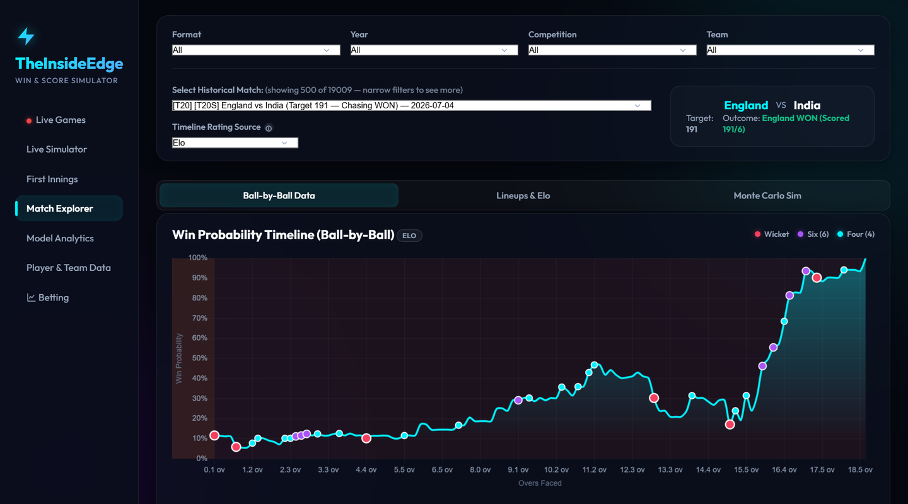
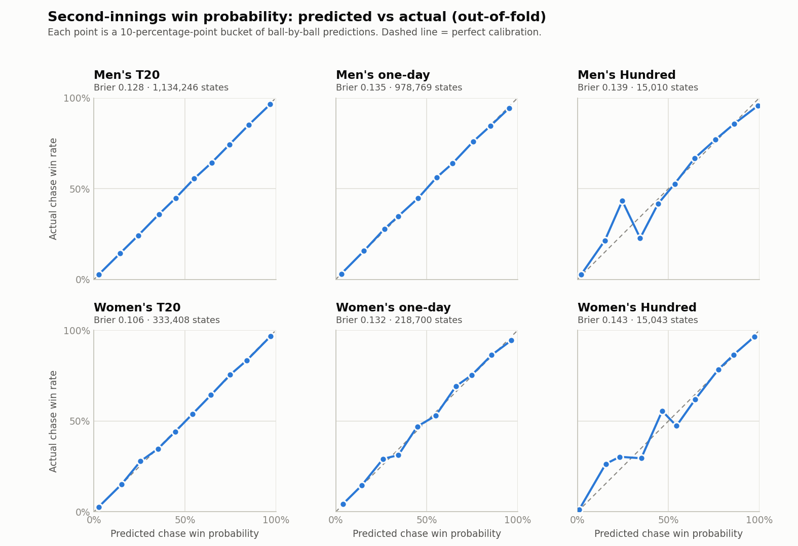
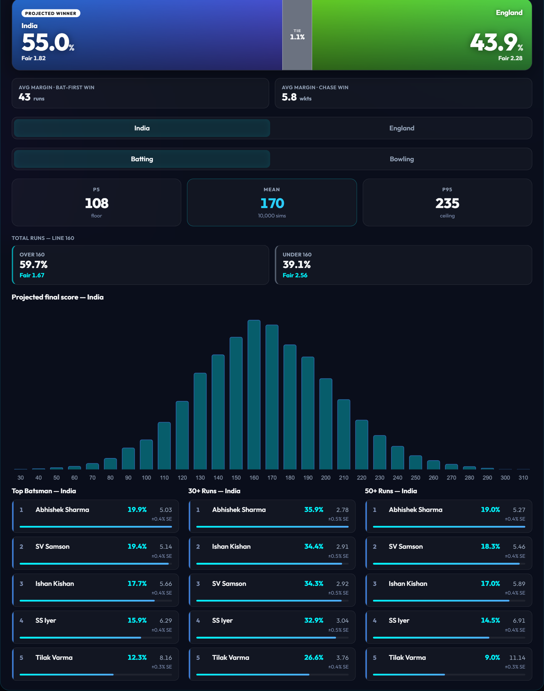

# TheInsideEdge: Cricket Win Probability and Match Simulation

Ball-by-ball win probability, first-innings score projection and Monte Carlo match simulation
for six formats: men's and women's T20, one-day and The Hundred. The models are trained on about
19,000 matches and 6.9 million deliveries from [Cricsheet](https://cricsheet.org). They are served
through a Flask web app that also prices live fixtures and logs paper bets against Betfair
Exchange prices.



---

## Results

Every figure below is **out-of-fold**: each prediction comes from a model that never saw that
match. Folds are grouped by match, and every rating feature uses only matches played earlier.

| Format | Chase states scored | Win-probability Brier | Brier skill vs base rate | First-innings MAE |
|--------|--------------------:|----------------------:|-------------------------:|------------------:|
| Men's T20 | 1,134,246 | 0.128 | 0.49 | 16.8 runs |
| Men's one-day | 978,769 | 0.135 | 0.46 | 31.1 runs |
| Men's Hundred | 15,010 | 0.139 | 0.44 | 20.4 runs |
| Women's T20 | 333,408 | 0.106 | 0.57 | 15.1 runs |
| Women's one-day | 218,700 | 0.132 | 0.47 | 31.0 runs |
| Women's Hundred | 15,043 | 0.143 | 0.43 | 16.1 runs |

- **Brier skill** is 1 − (model Brier ÷ Brier of always predicting the chasing side's historical
  win rate). Zero means no better than the base rate.
- **Skill is front-loaded by easy states.** Late in a chase the result is often nearly settled.
  For men's T20 the Brier score is 0.163 in the powerplay, 0.122 in the middle overs and 0.080 at
  the death. The powerplay figure is the fairer test of the model.
- **The Hundred** has only about 160 matches per gender. Each Hundred model borrows T20 data of
  the same gender at train time (it is never scored). For the men's model this took the Brier score
  from 0.178 to 0.141, beating a reused T20 model (0.143).
- **First-innings MAE** is the error in the projected final total, averaged over states sampled
  across the innings. For men's T20 it falls from 24.4 runs in the powerplay to 7.3 at the death.

<picture>
  <source media="(prefers-color-scheme: dark)" srcset="docs/img/calibration_dark.png">
  
</picture>

The predicted probabilities are well calibrated wherever there is enough data. The Hundred
panels are noisy because each covers only about 15,000 chase states.

---

## How it works

```
Cricsheet ball-by-ball YAML
        │
        ▼
Feature engines (chronological, cached per format)
  • team Elo: dynamic K-factor, margin of victory, time decay
  • player Elo for batters and bowlers, aggregated into squad strength
  • phase Elo (powerplay / middle / death) and venue scoring rates with Bayesian shrinkage
        │
        ▼
Three XGBoost models per format
  • second-innings win-probability classifier (5 match-grouped folds + a final model)
  • first-innings total regressor
  • per-ball delivery-outcome model (extras gate, then runs or wicket)
        │
        ▼
Monte Carlo simulator: 10,000 simulated matches → score distributions,
match odds, over/under lines, top batter and bowler markets
        │
        ▼
Flask app: live ESPNcricinfo scores, pre-match pricing, Betfair odds scanner, paper-bet ledger
```

Women's cricket is modelled as separate formats, not as a gender flag. Men's and women's matches
never share a rating pool, a par score or a training set.

### Guarding against leakage

Leakage is the easiest way for a sports model to look better than it is, so the pipeline is built
around preventing it:

- Every rating is recorded **before** the match it describes updates it.
- Cross-validation folds are grouped by match, so no two balls of the same match are split
  between training and test.
- Validation uses only the fold model that did not train on that match. A separate model trained
  on all data is used only for unseen matches.
- Two regression gates (`tests/regression_test.py` and `tests/sim_baseline_metrics.py`) check
  every format against locked baselines after each change.

---

## The Monte Carlo simulator

The simulator plays out matches one delivery at a time with the delivery-outcome model. It is
checked on 100 matches per format at 3,000 simulations each.

| Format | Innings-total MAE (gate) | Mean bias (gate) | 90% interval coverage (gate 70–95%) |
|--------|-------------------------:|-----------------:|--------------------------------:|
| Men's T20 | 27.5 (≤ 28.5) | −1.2 (± 8.0) | 86% |
| Men's one-day | 46.4 (≤ 52.8) | +12.7 (± 14.8) | 86% |
| Men's Hundred | 23.1 (≤ 24.5) | −3.4 (± 5.8) | 90% |
| Women's T20 | 22.9 (≤ 29.9) | +3.5 (± 8.4) | 89% |
| Women's one-day | 41.4 (≤ 50.0) | +11.2 (± 14.0) | 92% |
| Women's Hundred | 13.2 (≤ 17.4) | **−5.4 (± 4.9) ✗** | 91% |

Women's Hundred is the one open failure: it under-predicts innings totals by more than the gate
allows.

Simulated innings totals are hard to beat by much. For men's T20, predicting the historical median
every time gives an MAE of 29.2 runs; the simulator's 27.5 is a modest improvement. The original
target of 25.0 was dropped after the
[analysis](markdowns/win_predictor/t20_mae_gate_plan.md) showed that the best leakage-safe model on
the available data reaches only 26.3.

Pre-match, the simulator's win probability is only slightly better than the base rate. For men's
T20 its Brier score is 0.229 against 0.249 over 98 matches, a difference that is not statistically
significant.



---

## Paper trading: what happened

From 20 July to 28 August 2026 the pre-match scanner logged paper bets wherever its win
probability beat the Betfair Exchange price with the margin removed, staked at quarter-Kelly. No
real money was used.

| | |
|---|---|
| Settled bets | 122 (45 won) |
| Return on stake | −28.7% |
| Flat-stake return | −28.5% (standard error 9.3 points) |
| Expected wins, model's probabilities | 75.8 |
| Expected wins, market's probabilities | 52.5 |
| Brier score on these bets, model vs market | 0.276 vs 0.206 |

**The market was right and the model was not.** The loss is about three standard errors below
zero, so it is not bad luck. On the same 122 selections the market's probabilities were far better
calibrated than the model's. The model gave its selections a 62% chance on average; the market gave
them 43%, and they won 37% of the time. Bets with larger apparent edges did not win more often.

The lesson is adverse selection. Filtering for disagreement with a liquid market selects the
matches where the model is most wrong. Many of the largest "edges" were associate-nation fixtures
(Hong Kong v Thailand, Jersey v UAE, Portugal v Israel), where ratings rest on few, isolated
matches. Others look like data problems: one selection was priced at exactly 50%, which suggests a
missing team rating. In-play, the ball-by-ball model's skill is real, but it has only been
measured against outcomes, not against market prices, because historical in-play odds are costly
to source. The honest next step is market-relative: use the exchange price as a prior and test
whether the model adds anything to it, before trusting any edge.

The models have changed since these bets were placed, but nothing has yet been shown to fix this.

---

## What didn't work

- **An early "go for launch" call on the simulator was withdrawn.** It rested on 30 matches; a
  100-match rerun showed two of four gates failing.
  ([write-up](markdowns/betting/model_evaluation_summary.md))
- **A feedback loop biased the one-day simulator.** The simulator fed its own running score back
  into the model as a feature, inflating totals. Damping it cut the bias from +18.2 to +12.7 runs.
  ([write-up](markdowns/win_predictor/mc_runrate_feedback_plan.md))
- **Two Hundred player-Elo changes were reverted.** Experience-graded K-factors and
  opponent-quality weighting, carried over from T20 and one-day work, were tried and reverted:
  The Hundred's 162-match corpus could not support them.
  ([write-up](markdowns/win_predictor/hnd_player_elo_revamp_plan.md))
- **Associate-nation players topped the player-Elo rankings,** above Kohli and Buttler. Each
  competition's ratings are centred on its own average, so dominating weak opposition looks the
  same as dominating the IPL. That is a structural defect that no rescaling can fix; a
  cross-competition bridge is in progress.
  ([write-up](markdowns/win_predictor/competition_tier_calibration_analysis.md))
- **Two feature caches were silently stale for a long time.** A cache with no manifest entry was trusted
  without a check. Found and fixed, and the baselines were re-locked.
- **A hybrid model using market odds as a feature was shelved,** because historical odds data
  cost more than the project could justify.

More write-ups are indexed in [docs/README.md](docs/README.md).

---

## Running it

The match data and trained models are not in the repository: they are rebuilt from Cricsheet.
[docs/setup.md](docs/setup.md) has the full steps, including memory requirements.

```bash
py -m pip install -r requirements.txt
py scripts/import_and_retrain.py --full   # download all matches and train
py app.py                                  # http://127.0.0.1:5000
py tests/regression_test.py                # check against the locked baselines
```

## Repository layout

| Path | Contents |
|------|----------|
| `src/data_processing/` | Cricsheet import, parsing, per-format settings, game-state building |
| `src/features/` | Team, player, phase and venue rating engines |
| `src/models/` | Win-probability, first-innings and delivery-outcome models |
| `src/simulation/` | Monte Carlo match and innings simulator |
| `src/betting/` | Pre-match predictor, live scorecards, Betfair client, value scanner, bet ledger |
| `app.py`, `static/` | Flask API and single-page web UI |
| `tests/` | Regression gates, validation and experiment scripts |
| `scripts/` | Scheduled import and retrain, measurement and fitting scripts |
| `docs/`, `markdowns/` | System guide, setup guide and selected build plans |

Built with Python 3.14, pandas, XGBoost, scikit-learn, Flask and Chart.js. Match data from
[Cricsheet](https://cricsheet.org), released under the Open Data Commons Attribution License.
