# TheInsideEdge — System Architecture & Technical Guide

> A complete technical walkthrough of the T20 & ODI Win Probability Prediction System, from raw cricket match data to live web-based predictions.

---

## Table of Contents

1. [What This Project Does](#1-what-this-project-does)
2. [High-Level Architecture](#2-high-level-architecture)
3. [Project File Structure](#3-project-file-structure)
4. [Stage 1: Raw Data (YAML Files)](#4-stage-1-raw-data-yaml-files)
5. [Stage 2: Data Loading & Parsing](#5-stage-2-data-loading--parsing)
6. [Stage 3: Match Metadata Extraction](#6-stage-3-match-metadata-extraction)
7. [Stage 4: Feature Engineering](#7-stage-4-feature-engineering)
   - [4a. Team Elo Ratings](#7a-team-elo-ratings-elo_enginepy)
   - [4b. Venue Features](#7b-venue-features-venue_enginepy)
   - [4c. Player Elo Ratings](#7c-player-elo-ratings-player_elo_enginepy)
8. [Stage 5: State Building](#8-stage-5-state-building)
9. [Stage 6: XGBoost Model Training](#9-stage-6-xgboost-model-training)
   - [Win Probability Model](#9a-win-probability-model-xgb_win_probabilitypy)
   - [First Innings Predictor](#9b-first-innings-predictor-first_innings_predictorpy)
10. [Stage 7: Model Validation](#10-stage-7-model-validation)
11. [Stage 8: Flask Web Application](#11-stage-8-flask-web-application)
12. [Stage 9: Frontend UI](#12-stage-9-frontend-ui)
13. [End-to-End Data Flow: A Single Prediction](#13-end-to-end-data-flow-a-single-prediction)
14. [Key Concepts Glossary](#14-key-concepts-glossary)
15. [Monte Carlo Simulation — The `current_team_score` Feedback Loop](#15-monte-carlo-simulation--the-current_team_score-feedback-loop)

---

## 1. What This Project Does

TheInsideEdge is a **machine learning system** that predicts the probability of the chasing (batting second) team winning a cricket match, **ball-by-ball**, during the second innings of a T20 or ODI game.

Imagine you're watching a T20 match. India is chasing 180, and they're 95/3 after 12 overs. This system tells you: *"India has a 62% chance of winning right now."* As each ball is bowled — a boundary, a wicket, a dot ball — that percentage updates in real time.

It also predicts **first innings scores**: given the current state of the first innings (runs scored, wickets lost, overs bowled), it estimates what the final total will be.

---

## 2. High-Level Architecture

The entire system can be thought of as a pipeline with 9 stages:

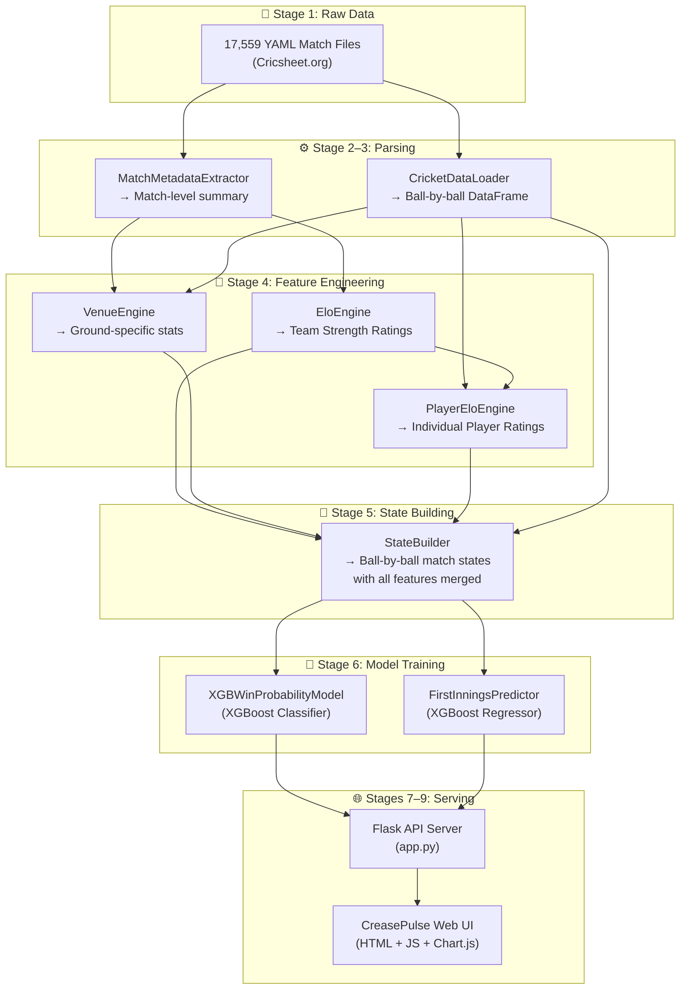

---

## 3. Project File Structure

```
T20_Win_Probability_Model/
│
├── data/
│   ├── raw/
│   │   ├── t20/                          # 11,592 T20 match YAML files
│   │   │   ├── ipl/                      # Indian Premier League
│   │   │   ├── bbl/                      # Big Bash League
│   │   │   ├── psl/                      # Pakistan Super League
│   │   │   ├── t20s/                     # T20 Internationals
│   │   │   └── ... (17 competitions)
│   │   └── od/                           # 5,967 ODI match YAML files
│   │       ├── odis/                     # One-Day Internationals
│   │       └── ... (5 competitions)
│   └── processed/                        # Cached parquet files & model pickles
│       ├── t20_cricket_data.parquet      # Parsed T20 deliveries
│       ├── t20_match_metadata.parquet    # T20 match summaries
│       ├── t20_elo_ratings.parquet       # T20 team Elo ratings
│       ├── t20_venue_features.parquet    # T20 venue statistics
│       ├── t20_player_elo_ratings.parquet # T20 player Elo ratings
│       ├── t20_xgb_models.pkl           # Trained T20 win prob. models
│       ├── t20_first_innings_regressor.pkl
│       ├── od_*.parquet / od_*.pkl       # Same set for ODI format
│       └── ...
│
├── src/
│   ├── data_processing/
│   │   ├── load_data.py                  # YAML → DataFrame parser
│   │   ├── match_metadata.py            # YAML → match-level metadata
│   │   └── build_states.py              # Deliveries → ball-by-ball states
│   ├── features/
│   │   ├── elo_engine.py                # Team-level Elo rating system
│   │   ├── venue_engine.py              # Venue-level rolling statistics
│   │   └── player_elo_engine.py         # Individual player Elo ratings
│   └── models/
│       ├── xgb_win_probability.py       # XGBoost classifier (win prob.)
│       └── first_innings_predictor.py   # XGBoost regressor (score pred.)
│
├── static/
│   ├── index.html                       # Single-page web application
│   ├── css/style.css                    # Glassmorphism dark-mode UI styling
│   └── js/app.js                        # Frontend logic & Chart.js charts
│
├── tests/
│   ├── win_probability_validation.py    # T20 model training & validation
│   ├── odi_validation.py               # ODI model training & validation
│   ├── first_innings_validation.py     # First innings regressor validation
│   └── ... (sweep scripts for hyperparameter optimization)
│
├── app.py                               # Flask web server (API + static files)
└── main.py                              # CLI entry point
```

---

## 4. Stage 1: Raw Data (YAML Files)

### Where the data comes from

All data originates from [Cricsheet.org](https://cricsheet.org), an open-source project that provides ball-by-ball match data for international and domestic cricket in YAML format.

The project contains **17,559 YAML files** across two cricket formats:
- **11,592 T20 matches** across 17 competitions (IPL, BBL, PSL, T20Is, etc.)
- **5,967 ODI matches** across 5 competitions (ODIs, ODMs, etc.)

### What a YAML file looks like

Each file represents one complete cricket match. Here is a simplified view of `1082591.yaml` (an IPL match):

```yaml
info:
  balls_per_over: 6
  city: Hyderabad
  competition: IPL
  dates: [2017-04-05]
  gender: male
  match_type: T20
  outcome:
    by:
      runs: 35
    winner: Sunrisers Hyderabad
  overs: 20
  players:
    Royal Challengers Bangalore: [CH Gayle, Mandeep Singh, ...]
    Sunrisers Hyderabad: [DA Warner, S Dhawan, Yuvraj Singh, ...]
  toss:
    decision: field
    winner: Royal Challengers Bangalore
  venue: Rajiv Gandhi International Stadium, Uppal

innings:
- 1st innings:
    team: Sunrisers Hyderabad
    deliveries:
    - 0.1:
        batsman: DA Warner
        bowler: TS Mills
        runs: {batsman: 0, extras: 0, total: 0}
    - 0.2:
        batsman: DA Warner
        bowler: TS Mills
        runs: {batsman: 0, extras: 0, total: 0}
    - 0.3:
        batsman: DA Warner
        bowler: TS Mills
        runs: {batsman: 4, extras: 0, total: 4}
    # ... hundreds more deliveries
```

Each YAML file contains two sections:
1. **`info`** — Match-level metadata: teams, venue, date, result, playing XIs, toss
2. **`innings`** — Every single delivery (ball) bowled, with batter, bowler, runs, wickets, and extras

---

## 5. Stage 2: Data Loading & Parsing

**File:** [load_data.py](file:///c:/Python/T20_Win_Probability_Model/src/data_processing/load_data.py)

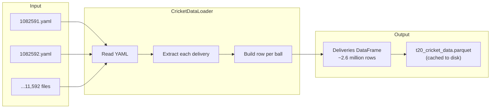

### What happens

The `CricketDataLoader` reads every YAML file (in parallel using `ProcessPoolExecutor` for speed) and flattens the nested delivery structure into a **single flat table** where each row is one ball bowled:

| match_id | innings | batting_team | over | ball | runs_off_bat | extras | total_runs | wicket | batter | bowler | is_wide | is_noball | match_date | venue | competition |
|----------|---------|-------------|------|------|-------------|--------|------------|--------|--------|--------|---------|-----------|------------|-------|-------------|
| 1082591 | 1 | Sunrisers Hyderabad | 0 | 1 | 0 | 0 | 0 | 0 | DA Warner | TS Mills | 0 | 0 | 2017-04-05 | Rajiv Gandhi... | ipl |
| 1082591 | 1 | Sunrisers Hyderabad | 0 | 3 | 4 | 0 | 4 | 0 | DA Warner | TS Mills | 0 | 0 | 2017-04-05 | Rajiv Gandhi... | ipl |

This produces approximately **2.65 million rows** for T20 matches and **2.64 million rows** for ODIs.

### Caching

Once parsed, the DataFrame is saved as a Parquet file (`data/processed/t20_cricket_data.parquet`). On subsequent runs, the loader reads directly from Parquet — skipping the slow YAML parsing entirely. This reduces load time from minutes to under 1 second.

---

## 6. Stage 3: Match Metadata Extraction

**File:** [match_metadata.py](file:///c:/Python/T20_Win_Probability_Model/src/data_processing/match_metadata.py)

While the data loader focuses on *deliveries*, the metadata extractor reads the `info` section of each YAML to build a **one-row-per-match summary**:

| match_id | date | competition | team_1 | team_2 | winner | win_margin | win_type | gender | venue | city | toss_winner | toss_decision | team_1_players | team_2_players |
|----------|------|-------------|--------|--------|--------|------------|----------|--------|-------|------|-------------|---------------|----------------|----------------|
| 1082591 | 2017-04-05 | ipl | Sunrisers Hyderabad | Royal Challengers Bangalore | Sunrisers Hyderabad | 35 | runs | male | Rajiv Gandhi... | Hyderabad | RCB | field | DA Warner,S Dhawan,... | CH Gayle,... |

### Why this matters

- `team_1` is always the team that **batted first** (determined by inspecting the first innings data)
- `team_2` is the team that **chased**
- `winner`, `win_margin`, and `win_type` are needed to update Elo ratings after each match
- `gender` is used to **filter to male-only matches** (a critical step that improved model accuracy by ~7%)
- `team_1_players` and `team_2_players` (comma-separated playing XI lists) are used for squad-level Elo calculations

---

## 7. Stage 4: Feature Engineering

This is where the system transforms raw match data into **meaningful signals** that the ML model can learn from. Three independent engines each produce a different layer of features.

### 7a. Team Elo Ratings (`elo_engine.py`)

**File:** [elo_engine.py](file:///c:/Python/T20_Win_Probability_Model/src/features/elo_engine.py)

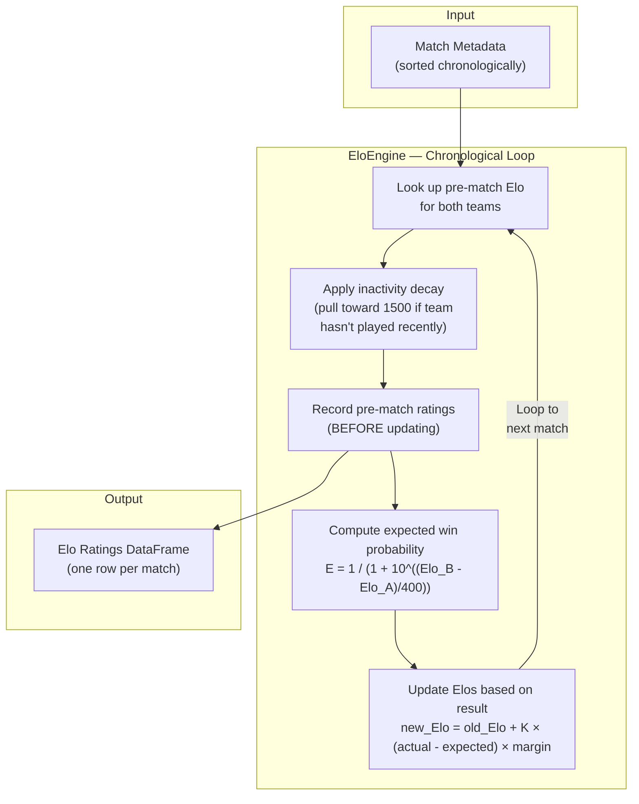

#### What is Elo?

Elo is a rating system originally designed for chess. Each team starts at **1500** (average). When a strong team beats a weak team, both ratings barely change. When a weak team beats a strong team, ratings shift dramatically. Over time, the ratings converge to reflect true relative strength.

#### Key features of this implementation

1. **Competition-pooled ratings** — Each competition (IPL, BBL, T20Is, etc.) maintains its own Elo pool. An IPL team's rating doesn't interfere with a T20I team's rating.

2. **Dynamic K-factor** — New teams have a higher K-factor (their ratings move faster) because there's more uncertainty. Experienced teams have lower K-factors (ratings are more stable).
   ```
   K = K_min + (K_max - K_min) / (1 + matches_played / K_scale)
   ```

3. **Margin-of-victory scaling** — A team winning by 50 runs gets a bigger Elo boost than one winning by 2 runs:
   - Runs: `multiplier = 1.0 + 0.5 × ln(1 + margin/10)`
   - Wickets: `multiplier = 1.0 + 0.1 × (margin - 1)`

4. **Inactivity decay** — If a team hasn't played for more than 90 days (T20) or 120 days (ODI), their rating decays toward 1500. This prevents stale ratings for inactive teams.

5. **Home advantage detection** — For T20 Internationals, the engine detects if a team is playing at home using a city-to-country mapping and applies a +50 Elo bonus.

6. **Chronological ordering** — Ratings are computed in strict date order. When predicting match N, only data from matches 1 through N-1 is used. This prevents **data leakage** (using future information to predict the past).

#### Output

| match_id | team_1 | team_2 | team_1_elo | team_2_elo |
|----------|--------|--------|------------|------------|
| 1082591 | Sunrisers Hyderabad | Royal Challengers Bangalore | 1587.3 | 1523.1 |

---

### 7b. Venue Features (`venue_engine.py`)

**File:** [venue_engine.py](file:///c:/Python/T20_Win_Probability_Model/src/features/venue_engine.py)

Different cricket grounds behave very differently. The MCG in Melbourne is known for low scores. Chinnaswamy in Bangalore is a batting paradise. This engine captures that.

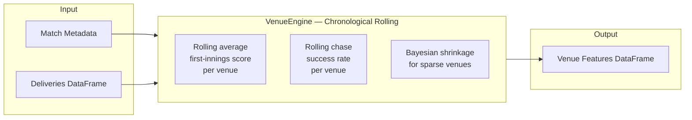

#### Features produced

| Feature | Description | Example |
|---------|-------------|---------|
| `venue_avg_first_innings_score` | Bayesian-smoothed rolling mean of first-innings totals at this ground | 172.4 |
| `venue_chase_success_rate` | Bayesian-smoothed rolling proportion of chases that succeeded | 0.48 |

#### Bayesian shrinkage

For a venue with only 2 matches, the raw average is unreliable. The engine blends the venue-specific average with the global average:

```
smoothed_avg = (venue_sum + smoothing_factor × global_avg) / (venue_count + smoothing_factor)
```

This pulls estimates for sparse venues toward the global mean, preventing wild extrapolation.

---

### 7c. Player Elo Ratings (`player_elo_engine.py`)

**File:** [player_elo_engine.py](file:///c:/Python/T20_Win_Probability_Model/src/features/player_elo_engine.py)

Individual players matter enormously in cricket. Having Virat Kohli at the crease is fundamentally different from having a tail-ender batting. This engine computes individual ratings.

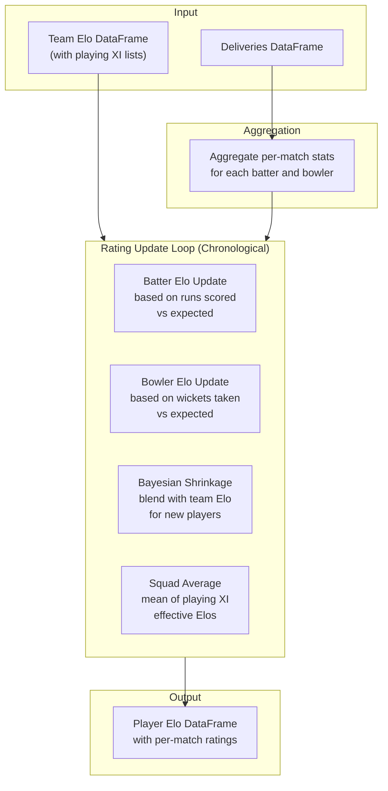

#### Bayesian shrinkage for cold-start players

A player who has played only 2 matches has unreliable ratings. The engine uses a sigmoid-like reliability blend:

```
reliability = matches_played / (matches_played + min_matches_reliable)
effective_elo = reliability × raw_elo + (1 - reliability) × team_elo
```

A brand-new player (0 matches) effectively inherits their **team's Elo**. After ~10 matches, their own rating dominates.

#### Frontline-bowler eligibility (`frontline_bowler_eligibility_plan.md`, 2026-08-07)

A bowling Elo, once earned, never expires — a specialist batter who bowled a handful of overs
years ago still carries a `role="bowler"` rating today, and shrinkage (above) anchors that stale
rating near the team's own strength, which can outrank genuine frontline bowlers rated below
1500. `t20`'s and `od`'s `bowling_squad_elo` is a top-K *rank-weighted* mean (not a flat mean —
see `_weighted_mean_by_bowling_rank`, K=6), so who occupies that top-K matters: `bowling_squad_elo`
and `squad_elo_diff` are ranked using `get_recent_bowl_rate(player)` (share of the player's
trailing 10 named appearances in which they actually bowled — `FRONTLINE_BOWL_WINDOW`/
`FRONTLINE_BOWL_MIN_RATE` in `player_elo_engine.py`) rather than merely "has ever bowled." The
per-player Elo *value* is unaffected — only which players are eligible to occupy a top-K rank
slot. `hnd`/`t20w`/`odw`/`hndw` use a flat (uniform-weight) mean, so this eligibility gate is a
provable no-op for them regardless of threshold — confirmed both synthetically and via a
byte-identical column hash on real data.

The live/historical squad-serving side (Lineup cards, Monte Carlo attack selection) uses the
same threshold via `frontline_bowl_sort_key` in `match_simulator.py`, with one deliberate
asymmetry: serving may use in-match ground truth (`known_bowler`) since that's leakage-fine for
simulating an already-known XI, but the training loop never does.

#### Features produced

| Feature | Description |
|---------|-------------|
| `batter_elo` | Current batter's effective Elo rating |
| `bowler_elo` | Current bowler's effective Elo rating |
| `player_elo_diff` | batter_elo − bowler_elo |
| `batting_squad_elo` | Mean effective batting Elo of the batting team's playing XI |
| `bowling_squad_elo` | Mean effective bowling Elo of the bowling team's playing XI |
| `squad_elo_diff` | batting_squad_elo − bowling_squad_elo |

---

## 8. Stage 5: State Building

**File:** [build_states.py](file:///c:/Python/T20_Win_Probability_Model/src/data_processing/build_states.py)

This is where everything comes together. The `StateBuilder` transforms raw deliveries into complete **match states** — a snapshot of the game at every single ball.

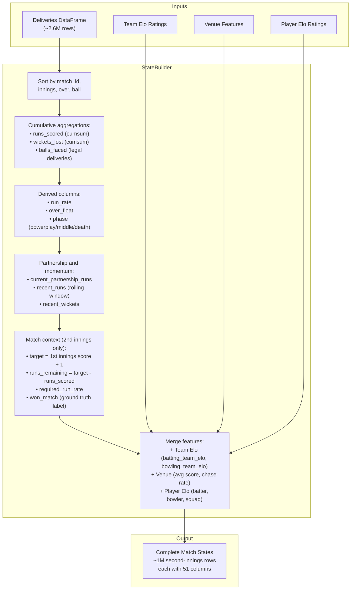

### What a single state row looks like

Here is one row from the states DataFrame — representing ball 4 of over 12 in the second innings of match 1082591:

| Column | Value | Meaning |
|--------|-------|---------|
| `match_id` | 1082591 | Unique match identifier |
| `innings` | 2 | Second innings (chase) |
| `over` | 12 | Current over number |
| `ball` | 4 | Ball within the over |
| `batting_team` | Royal Challengers Bangalore | Who is batting |
| `batter` | KM Jadhav | Current striker |
| `bowler` | Rashid Khan | Current bowler |
| `runs_scored` | 87 | Cumulative runs so far |
| `wickets_lost` | 3 | Cumulative wickets fallen |
| `balls_faced` | 75 | Legal deliveries bowled |
| `balls_remaining` | 45 | Legal deliveries left |
| `run_rate` | 6.96 | Current run rate |
| `target` | 208 | Runs needed to win |
| `runs_remaining` | 121 | Runs still needed |
| `required_run_rate` | 16.13 | RRR to win from here |
| `phase` | middle | Game phase |
| `batting_team_elo` | 1523.1 | Team strength rating |
| `bowling_team_elo` | 1587.3 | Opponent strength |
| `batter_elo` | 1612.4 | Striker's individual rating |
| `bowler_elo` | 1702.8 | Bowler's individual rating |
| `venue_avg_first_innings_score` | 172.4 | Historical ground average |
| `won_match` | 0 | **Ground truth**: did they win? |

### Key design decisions

- **Only second-innings states are used for win probability** — because win probability only makes sense when there's a target to chase
- **First-innings states are used for score prediction** — predicting what the final total will be
- **`won_match`** is the **binary label** (0 or 1) that the model learns to predict
- All features use **only information available at or before that ball** — no future leakage

---

## 9. Stage 6: XGBoost Model Training

### 9a. Win Probability Model (`xgb_win_probability.py`)

**File:** [xgb_win_probability.py](file:///c:/Python/T20_Win_Probability_Model/src/models/xgb_win_probability.py)

This is the core machine learning model. It takes a match state and predicts the probability (0.0 to 1.0) that the chasing team will win.

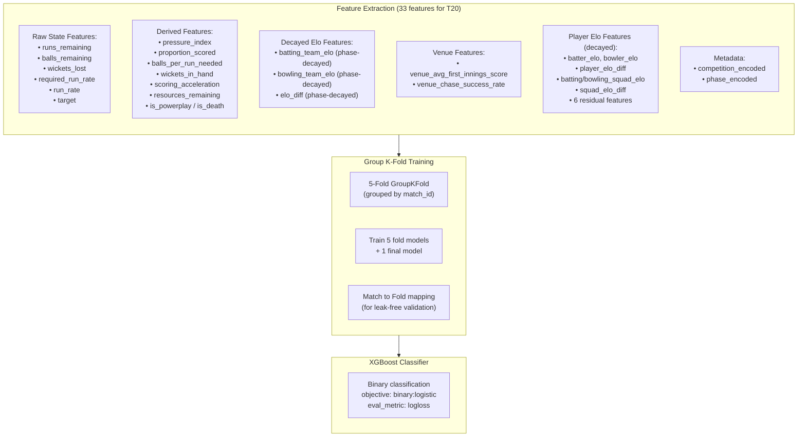

#### Feature Engineering Detail: Phase-Based Elo Decay

A critical innovation is that **team and player Elo features are decayed based on the match phase**. The intuition: team strength matters most at the start of an innings (when there are many balls left and team composition drives strategy). By the death overs, the game state itself (runs needed, balls left, wickets in hand) dominates — team identity matters less.

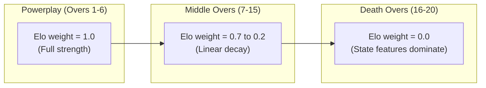

The decay is computed as:
```
decay_weight = clamp((balls_remaining - death_start_balls) / middle_duration, 0, 1)
decayed_elo = 1500 + (raw_elo - 1500) × decay_weight
```

#### Feature Engineering Detail: Residual Player Elo

In addition to the raw (decayed) player Elo features, the model uses **residual features** — the difference between a player's Elo and their team's Elo:

```
residual_batter_elo = (batter_elo - team_batting_elo) × decay_weight
```

This captures "how much better (or worse) is this specific batter compared to an average member of their team?" — a signal that's independent of team strength.

#### Feature Engineering Detail: Pressure Index

The pressure index combines required run rate with wicket pressure, normalised by match progress:

```
wicket_pressure = wickets_lost × (total_balls / max(balls_remaining, 1))
pressure_index = (required_run_rate / baseline_rr) × (1 + wicket_pressure / 10)
```

This means: needing 12 runs per over with 8 wickets down and 6 balls left creates **extreme** pressure, while needing 8 RPO with 0 wickets down and 60 balls left is quite manageable.

#### Group K-Fold Cross-Validation

A standard train/test split would cause **data leakage** — the model could see balls from the same match in both training and test sets, learning match-specific patterns instead of general ones.

The solution is **Group K-Fold** where all balls from the same match are always in the same fold:

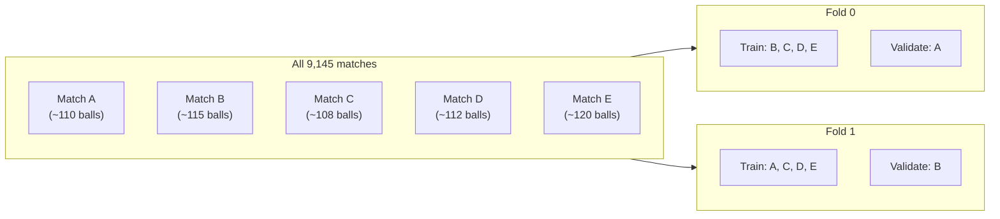

Each match is assigned to exactly one fold. When predicting for a match during validation, the model trained on the **other 4 folds** (which never saw that match) is used. This produces honest, leak-free evaluation metrics.

A **6th "final" model** is trained on 100% of the data — this is used for live predictions on new, never-seen matches.

---

### 9b. First Innings Predictor (`first_innings_predictor.py`)

**File:** [first_innings_predictor.py](file:///c:/Python/T20_Win_Probability_Model/src/models/first_innings_predictor.py)

While the win probability model only works during the second innings (when there's a target), the first innings predictor answers: *"Based on the current first-innings state, what will the final score be?"*

It uses an **XGBoost Regressor** (not a classifier) with features like:
- `runs_scored`, `wickets_lost`, `balls_faced`, `balls_remaining`
- `run_rate`, `projected_score` (simple linear projection)
- `resources_remaining` (wickets × balls)
- Team Elos, venue average, phase, competition

The training label is `final_first_innings_score` — the actual total the team scored.

---

## 10. Stage 7: Model Validation

**Files:** [win_probability_validation.py](file:///c:/Python/T20_Win_Probability_Model/tests/win_probability_validation.py), [odi_validation.py](file:///c:/Python/T20_Win_Probability_Model/tests/odi_validation.py)

### Brier Score

The primary metric is the **Brier Score**, which measures the accuracy of probability predictions:

```
Brier Score = (1/N) × Σ(predicted_probability - actual_outcome)²
```

- `actual_outcome` is 0 (loss) or 1 (win)
- A perfect model scores **0.0**
- A coin-flip model (always predicting 0.5) scores **0.25**
- Lower is better

### Current performance

| Model | Brier Score | Interpretation |
|-------|------------|----------------|
| T20 Win Probability | **0.1318** | Excellent — well-calibrated predictions |
| ODI Win Probability | **0.1324** | Excellent — slightly harder due to longer format |
| Random baseline | 0.2500 | Predicting 50/50 every time |

### Calibration

A well-calibrated model means: when it says "70% chance of winning", the chasing team actually wins ~70% of the time. The model is validated using calibration buckets:

| Predicted Range | Actual Win Rate | Count |
|----------------|----------------|-------|
| 0% – 10% | 4.1% | 1,154 |
| 20% – 30% | 27.7% | 393 |
| 40% – 50% | 49.3% | 300 |
| 60% – 70% | 65.9% | 367 |
| 90% – 100% | 95.5% | 862 |

The predicted and actual values track each other closely — the model is well calibrated.

---

## 11. Stage 8: Flask Web Application

**File:** [app.py](file:///c:/Python/T20_Win_Probability_Model/app.py)

The Flask server bridges the trained models and the web frontend.

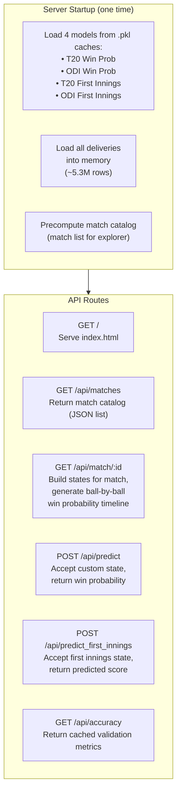

### The `/api/match/:id` endpoint — the heart of the app

When a user selects a historical match in the UI, this endpoint:

1. **Filters** the in-memory deliveries to just that match
2. **Detects** the format (T20 or ODI) by checking `max(over)`
3. **Loads** the appropriate Elo and player Elo data from Parquet
4. **Builds states** using `StateBuilder` — creating the ball-by-ball game snapshots
5. **Filters** to second innings only
6. **Calls `model.predict()`** for every single ball in the chase
7. **Returns** a JSON timeline array with win probability at each delivery

This is the same pipeline as training, but applied to a single match in real time.

---

## 12. Stage 9: Frontend UI

**Files:** [index.html](file:///c:/Python/T20_Win_Probability_Model/static/index.html), [app.js](file:///c:/Python/T20_Win_Probability_Model/static/js/app.js), [style.css](file:///c:/Python/T20_Win_Probability_Model/static/css/style.css)

The frontend is a **single-page application** built with vanilla HTML/CSS/JavaScript and Chart.js for visualisation.

### Tabs

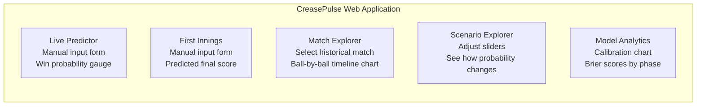

### How the Match Explorer works

1. On page load, the app fetches `/api/matches` to populate a dropdown of all historical matches
2. User selects a match (e.g., "India vs Australia, Target: 175")
3. App calls `/api/match/1082591` and receives a JSON timeline
4. Chart.js renders a **line chart** showing win probability (0–100%) on the Y-axis and balls bowled on the X-axis
5. Key moments (wickets, boundaries) are visible as sharp changes in the line

---

## 13. End-to-End Data Flow: A Single Prediction

Let's trace exactly what happens when the model predicts "India has a 62% chance of winning at ball 75 of the chase":

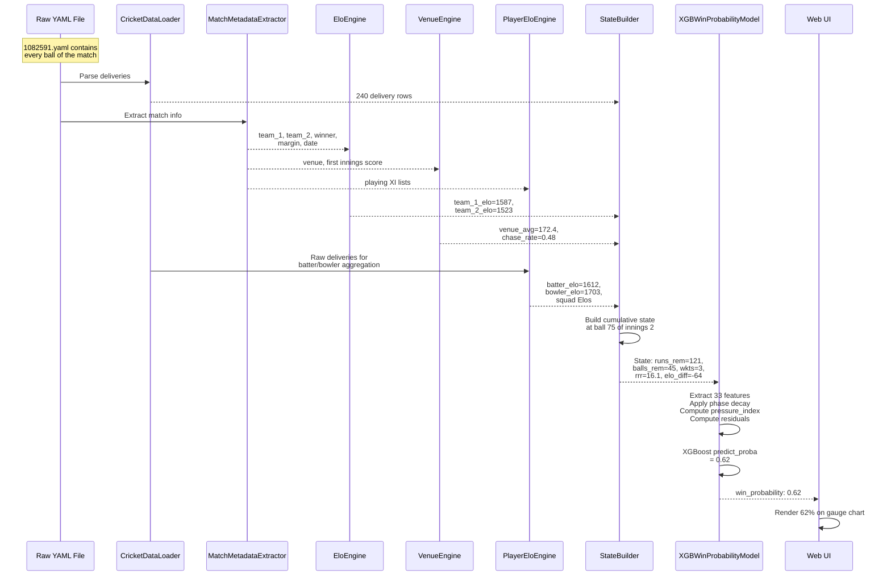

### The 33 T20 features used by the model

| # | Feature | Category | Description |
|---|---------|----------|-------------|
| 1 | `runs_remaining` | Game State | How many more runs are needed |
| 2 | `balls_remaining` | Game State | Legal deliveries left |
| 3 | `wickets_lost` | Game State | Number of batters dismissed |
| 4 | `required_run_rate` | Game State | Runs needed per over remaining |
| 5 | `run_rate` | Game State | Current scoring rate |
| 6 | `target` | Game State | Total runs the chasing team needs |
| 7 | `pressure_index` | Derived | Combined RRR + wicket + progress pressure |
| 8 | `phase_encoded` | Derived | 0=powerplay, 1=middle, 2=death |
| 9 | `batting_team_elo` | Team Strength | Batting team's decayed Elo |
| 10 | `bowling_team_elo` | Team Strength | Bowling team's decayed Elo |
| 11 | `elo_diff` | Team Strength | Batting minus Bowling (decayed) |
| 12 | `venue_avg_first_innings_score` | Venue | Historical ground average |
| 13 | `venue_chase_success_rate` | Venue | Historical chase win % |
| 14 | `resources_remaining` | Derived | wickets_in_hand times balls_remaining |
| 15 | `proportion_scored` | Derived | Fraction of target already scored |
| 16 | `balls_per_run_needed` | Derived | Balls available per run needed |
| 17 | `wickets_in_hand` | Derived | 10 minus wickets_lost |
| 18 | `scoring_acceleration` | Derived | run_rate / required_run_rate |
| 19 | `is_powerplay` | Phase | Binary: is powerplay? |
| 20 | `is_death` | Phase | Binary: is death overs? |
| 21 | `competition_encoded` | Metadata | Numeric ID for competition (0-16) |
| 22 | `batter_elo` | Player | Current batter's decayed Elo |
| 23 | `bowler_elo` | Player | Current bowler's decayed Elo |
| 24 | `player_elo_diff` | Player | batter minus bowler (decayed) |
| 25 | `batting_squad_elo` | Player | Team's playing XI batting average (decayed) |
| 26 | `bowling_squad_elo` | Player | Team's playing XI bowling average (decayed) |
| 27 | `squad_elo_diff` | Player | Batting XI minus Bowling XI (decayed) |
| 28 | `residual_batter_elo` | Residual | batter minus team batting Elo (decayed) |
| 29 | `residual_bowler_elo` | Residual | bowler minus team bowling Elo (decayed) |
| 30 | `residual_player_elo_diff` | Residual | player diff minus team diff (decayed) |
| 31 | `residual_batting_squad_elo` | Residual | squad bat minus team Elo (decayed) |
| 32 | `residual_bowling_squad_elo` | Residual | squad bowl minus team Elo (decayed) |
| 33 | `residual_squad_elo_diff` | Residual | squad diff minus team diff (decayed) |

---

## 14. Key Concepts Glossary

| Term | Explanation |
|------|-------------|
| **Elo Rating** | A numerical strength rating (centered at 1500) that goes up when you win and down when you lose. Originally from chess. |
| **XGBoost** | "Extreme Gradient Boosting" — a machine learning algorithm that builds hundreds of small decision trees, each one correcting the mistakes of the previous ones. Very effective for tabular data. |
| **Brier Score** | A metric for probability predictions. Measures the average squared difference between predicted probability and actual outcome (0 or 1). Lower = better. |
| **Data Leakage** | When a model accidentally learns from information that wouldn't be available at prediction time. Example: using match N's result to predict match N-1's Elo. |
| **Group K-Fold** | A cross-validation strategy where all data from the same group (match) stays together. Prevents the model from memorising match-specific patterns. |
| **Bayesian Shrinkage** | A technique for handling sparse data by blending a specific estimate (e.g., a venue's average) with a global estimate. Prevents wild extrapolation from small samples. |
| **Phase-Based Decay** | The idea that team strength ratings matter more early in an innings and less as the game state itself becomes dominant in the death overs. |
| **Residual Features** | The difference between a player's rating and their team's rating. Captures "how much better/worse is this individual compared to an average teammate?" |
| **Parquet** | A columnar binary file format for fast reading/writing of large DataFrames. Much faster than CSV. |
| **Flask** | A lightweight Python web framework used to serve API endpoints and static files. |

---

## 15. Monte Carlo Simulation — The `current_team_score` Feedback Loop

**Files:** [innings_simulator.py](file:///c:/Python/T20_Win_Probability_Model/src/simulation/innings_simulator.py), [match_simulator.py](file:///c:/Python/T20_Win_Probability_Model/src/simulation/match_simulator.py), [delivery_outcome_model.py](file:///c:/Python/T20_Win_Probability_Model/src/models/delivery_outcome_model.py)

Alongside the ball-by-ball win-probability classifier described above, this project runs a
separate **Strategy 4 Monte Carlo simulator**: a two-stage `DeliveryOutcomeModel` (extras gate,
then legal-outcome multinomial) samples one delivery at a time, thousands of times in parallel,
to project full innings and match outcomes for markets like total runs, top bowler, and
win-probability cross-checks. This section documents a non-obvious property of that simulator
that cost real calibration accuracy before it was understood — see
`markdowns/win_predictor/mc_runrate_feedback_plan.md` for the full investigation and numbers;
this is the short version so it isn't rediscovered the hard way.

### The problem: an input that is also an output

`current_team_score` is one of the delivery-outcome model's training features — and legitimately
so: a high score at a given point in an innings really does predict continued fast scoring (good
pitch, strong batting side), and the model learns that correlation correctly from real matches.

Inside a *simulation*, though, `current_team_score` is not an independent observation — it's the
simulator's **own accumulated output**, fed straight back in as a feature on the next delivery.
Any early over-prediction inflates the score the model sees, which (correctly, per what it
learned in training) makes it predict *more* scoring, which inflates the score further. The loop
has gain < 1, so it settles at a stable inflated level rather than diverging — which is why od's
innings-total bias plateaued at roughly **+18 runs (+14%)** high rather than blowing up, but it
was still failing its calibration gate (`|bias| <= 13.0`).

### The fix: damp the fed-back value, not the model

`_assemble_state_matrix()` shrinks the `current_team_score` value it feeds to the model toward a
per-format, per-ball-index **par trajectory** (mean score at that ball across real matches that
were still batting at that point — `data/processed/{format}_score_trajectory.json`, built by
`scripts/build_score_trajectory.py`):

```python
fed_score = expected_trajectory[ball_index] + SHRINK * (raw_simulated_score - expected_trajectory[ball_index])
```

`SHRINK` is a **per-format constant** (`SCORE_FEEDBACK_SHRINK` in `innings_simulator.py`, same
pattern as `BOWLER_OVER_SHARES`) — od and t20 have measurably different loop *gain* per run of
score, so there's no reason to expect one shared value fits both:

| Format | `SCORE_FEEDBACK_SHRINK` | Why |
|---|---:|---|
| `od` | **0.30** | Clears the bias gate (+18.17 → +12.72 at full canonical fidelity) with margin below the measured crossing point (~0.33–0.35) |
| `t20` | **1.0** (no damping) | Bias barely moves across the *entire* [0,1] shrink range — nothing here for damping to fix, even though t20's per-run sensitivity is actually steeper than od's |

`SHRINK = 1.0` reproduces pre-fix behaviour **byte-identically** (a fast-path in `_fed_score()`
skips the trajectory arithmetic entirely), which is what makes this change safely reversible per
format. Only the *value fed to the model* is damped — mechanical uses of the real score
(`required_run_rate`, simulation termination, market pricing) are untouched.

> [!NOTE]
> Damping only explains **~35–36%** of od's baseline bias, not the ~58% an early back-of-envelope
> estimate suggested (two independent full simulations at zero damping confirmed this). Even at
> maximum damping, roughly **+10 runs of bias remains** — checked against every tracked per-ball
> feature and a joint (wickets, over) snapshot, and it shows up in none of them. It's a genuine
> open question, not something this fix was expected to fully close (MAE was never in scope
> either — see the plan doc's `Deferred` section).

### t20's innings-total MAE gate: measured ceiling and re-anchor (2026-08-11)

t20's Monte Carlo innings-total MAE gate was originally **25.0**, an empirically-chosen number
never validated against a skill ceiling. `markdowns/win_predictor/t20_mae_gate_plan.md` measured
that ceiling directly (5-fold OOF, leakage-safe, named-XI squad Elo only — never participant-
derived, which encodes the outcome):

| Quantity | Value |
|---|---:|
| Zero-skill floor (predict the median every time) | 29.19 |
| Simulator, locked | 27.48 (median-based MAE — see Phase 1's estimator fix below) |
| Best leakage-safe regressor, everything this repo holds (venue par, team Elo, named-XI squad Elo, competition, era, toss) | **26.29** (OOF R² 20.3%) |

**25.0 is not attainable from the data this repo currently holds.** A direct match-level
regressor given every available pre-match feature tops out at 26.29 — still 1.29 runs over the
old gate. Closing the remainder needs information the repo does not have (pitch/dew/weather,
confirmed team news, ground dimensions): a data-acquisition project, not a modelling one.

Two things worth separating, because they are genuinely different findings:
- **The point-estimator fix (Phase 1) is real and shipped.** MAE is minimised by the median, not
  the mean, on the simulator's left-skewed score distribution — `MAE_POINT_ESTIMATE = {"t20":
  "median"}` in `generate_mc_calibration_metrics.py`, moving the locked MAE 27.5735 → 27.48 with
  every other calibration metric reproducing byte-identically. `bias` stays mean-based
  unconditionally — it estimates expectation, not absolute error, and the two are deliberately
  not the same statistic.
- **A squad-context retrain (Phase 2/3) is NOT justified.** A subsampled, control-relative,
  match-paired OOF ablation of the delivery-outcome model (800 matches, 2/5 GroupKFold folds)
  found that adding `batting_squad_elo`/`bowling_squad_elo` moves per-ball legal-outcome log-loss
  by essentially nothing (t=+0.38 — noise), and adding competition/era/toss alongside it still
  falls short of this repo's own `|t|>2` bar (t=−1.74). The match-level regressor's squad-Elo
  signal (R² 11.7%→18.6%) is real at the *aggregate* level but too diffuse for a per-ball metric
  to confirm at this sample size — the two measurements are not in conflict, they're answering
  different questions. No retrain was performed.

**The gate is re-anchored to 28.5** — `_T20_MAE_MAX` in `tests/one-time/generate_mc_calibration_
metrics.py` (and its synced duplicate assertion in `test_simulation_calibration.py`) — computed
as the measured ceiling (26.29) plus ~1 sampling-noise SE (2.28, the per-match absolute-error SE
measured on the 100-match calibration sample). This is a **deliberate, human-approved decision**,
not a measurement: two other bases were on the table (a fixed fraction of the zero-skill floor;
leaving 25.0 permanently red as a documented aspiration) and this one was chosen because it stays
a real, evidence-grounded bar — it still fails the zero-skill floor (29.19) and would catch a
genuine regression — while not rejecting a simulator that is already within noise of the honest
ceiling. Every other format's MAE gate is derived from this same constant via the dispersion-based
`innings_total_sd` scaling (`_calibration_targets()`), so this decision moved every format's gate
at once, not just t20's.

---

*This document describes the CreasePulse system as of July 2026. T20 Brier Score: 0.1318 | ODI Brier Score: 0.1324.*
